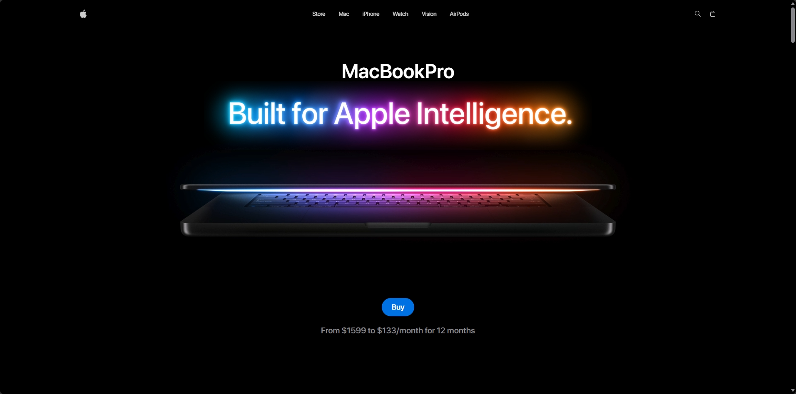
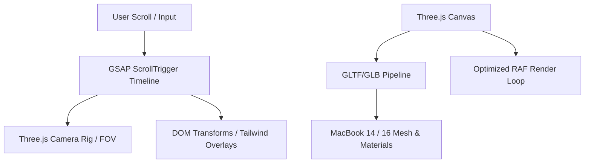

# Apple Website Clone

> Beautiful, 3D interactive website built with React, TypeScript, Tailwind, GSAP, and THREE.js.

[](LICENSE.txt)
[](https://sophanethsy.netlify.app/)



A high-performance clone of the Apple MacBook showcase page, combining interactive WebGL graphics with seamless scroll-driven animation timelines. Built to emulate Apple's industrial design language with 60 FPS graphics performance.

---

## ⚡ Highlights & Key Features

- **Interactive 3D Stage**: Real-time inspection and customization of Apple MacBook hardware with dynamic lighting, material roughness, and camera controls.
- **Scroll-Driven Storytelling**: GSAP ScrollTrigger orchestrates hardware component explodes, screen reveals, and section transitions tied directly to user scroll position.
- **Dynamic Asset Swapping**: Responsive loading of high-detail 14-inch and 16-inch GLTF models (`.glb`) based on device capabilities and viewport breakpoints.
- **Apple Typography & Polish**: Self-hosted San Francisco font weights (Ultralight through Black) and Cupertino dark-mode aesthetics using Tailwind CSS.

---

## 🏗️ Technical Architecture



### Tech Stack

- **React & TypeScript**: Provides declarative component management, strict typing, and clear lifecycle hooks for external WebGL canvas contexts.
- **Three.js**: 3D rendering pipeline that enables complex materials rendering without high abstraction overhead.
- **GSAP (GreenSock)**: Chosen for buttery-smooth timeline synchronization and rendering accuracy.
- **Tailwind CSS**: Rapid utility styling for typography scales and responsive break-points.

### 🚀 Getting Started

## Prerequisites

- Node.js (version 18+ recommended)
- npm or pnpm

## 1. Installation

```bash
git clone https://github.com/your-username/apple-website-clone.git
cd apple-website-clone
npm install
```

## 2. Development Server

```bash
npm run dev
```

Open [http://localhost:5173](http://localhost:5173) in your browser to view the application.

## 3. Production Build

```bash
npm run build
npm run preview
```
